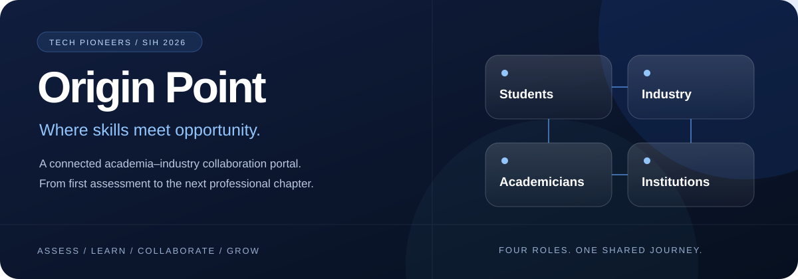
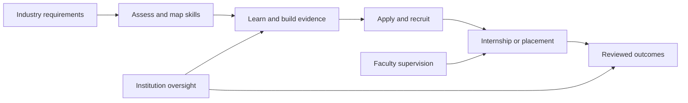

<div align="center">



**One platform. Four connected roles. A clearer path from learning to opportunity.**


[The platform](#four-portals-one-connected-workflow) · [Run locally](#run-locally) · [Evaluate](#evaluate-the-prototype) · [Documentation](#go-deeper)

</div>

---

## Built for the gap between education and employment

Students need to understand which skills matter and how to turn learning into experience. Industry needs evidence of capability. Faculty need practical exposure. Institutions need visibility into the journey—not just a final placement number.

**Origin Point** connects those needs through persistent, role-based workflows: skill assessment, learning, applications, supervised internships, recruitment and institutional oversight.

> **Tech Pioneers · SIH 2026**<br>
> **SIH26044** — Portal for Academia–Industry collaboration for Skill Mapping, Internships and Placement<br>
> **Theme:** Smart Automation · **Ministry:** Ministry of Ayush<br>
> Submission context, not an endorsement, accreditation or production-deployment claim.

## Four portals. One connected workflow.

| Portal | What you can do | How it connects |
| :-- | :-- | :-- |
| **Student** | Build a portfolio, assess skills, explore opportunities, plan learning, apply and track progress. | Share application evidence with recruiters and progress with an approved institution. |
| **Industry** | Publish opportunities and programs, author assessments, manage recruitment and review internship work. | Define skill requirements, review applicants and guide practical learning. |
| **Academician** | Explore FDPs and faculty internships, supervise students and participate in research collaborations. | Accept supervision assignments and join consent-based industry workspaces. |
| **Institution** | Approve memberships, coordinate supervision, review credentials and inspect readiness/outcome analytics. | Monitor the authorized cohort using saved records and explicit access rules. |



## What makes the prototype different

### Evidence before scores

Self-declared skills, assessment-backed evidence, learning participation and reviewed outcomes remain distinct. Matching explains skill coverage and gaps; it is **not a hiring probability or a guarantee of employability**.

### Connected workflows, not disconnected dashboards

Applications have shared timelines. Internship acceptance leads to milestones, progress reports and authorized review. Written job offers and two-party joining confirmations are separate events. Institution dashboards reflect approved membership and saved activity.

### AI with context and boundaries

Gemini supports practice questions, assessment-authoring drafts, match explanations and learning-plan drafts. Relevant prompts and validation shape outputs; **this is API-based prompting, not a custom-trained model**. Consent, private answer keys, server-side scoring and shared per-account allowances apply where implemented. Provider failure does not create invented results.

### A considered interface

Glassmorphism surfaces, role-themed workspaces, subtle hover interactions, responsive navigation and clear loading/error/empty states make complex workflows easier to follow.

## Feature highlights

- **Skills & portfolios:** projects, certifications, private documents, canonical skill aliases, assessment reports, readiness views and credential-review history.
- **Assessments:** industry-authored versioned questionnaires, private answer keys, server-side scoring, assessment-gated applications and independently reviewed question-bank workflows.
- **Learning:** publisher-authored tracks, professional program listings, enrollment, submissions, reviews, workshop registration, attendance and feedback.
- **Recruitment:** applications, timelines, interviews/rescheduling, calendar exports, written offers, responses and two-party joining confirmation.
- **Internships:** accepted arrangements, industry/faculty supervision, milestones, progress logs, private report versions and reviewed completion records.
- **Collaboration:** research proposals, project milestones, consent-based teams, private attachments, innovation challenges and mentorship journals.
- **Institution intelligence:** authorized cohort dashboards, roster invitations, skill-demand views, monthly outcome charts and scoped exports.
- **Trust & notifications:** organization verification with explicitly provisioned reviewers, private paginated inboxes and an optional opt-in email delivery worker.

Availability depends on database migrations and external-service configuration. An implemented screen does not mean every integration is deployed.

## Technology stack

| Layer | Technologies |
| :-- | :-- |
| Application | Next.js 15 App Router, React 19, TypeScript and JavaScript |
| Interface | Tailwind CSS, Base UI, shadcn-style components, Framer Motion, Lucide |
| Data & validation | SWR, Zod, React Hook Form |
| Backend | Supabase PostgreSQL, Auth, row-level security, SQL functions, private Storage |
| AI | Google Gemini API / Google Generative AI SDK |
| Analytics | Recharts and deterministic calculations over authorized records |
| Email | Resend-backed account/email workflows and optional queued notification delivery |
| Verification | Node.js test runner, PGlite PostgreSQL fixtures, TypeScript and Next.js builds |

## Run locally

Use **Node.js 22 or 24** and npm. You need your own Supabase project; no private environment file or database backup is included.

```sh
git clone https://github.com/Rajj-c/SIH_26.git
cd SIH_26
npm ci
cp .env.example .env.local
```

### 1. Configure the environment

Use `.env.example` as the reference:

- `NEXT_PUBLIC_SUPABASE_URL` and `NEXT_PUBLIC_SUPABASE_ANON_KEY`: browser/server access under database policies.
- `SUPABASE_SERVICE_ROLE_KEY`: privileged server/provisioning workflows only. Never expose it in a public variable or client bundle.
- `NEXT_PUBLIC_APP_URL`: exact application origin for callbacks and account flows.
- `GEMINI_API_KEY` and `GEMINI_MODEL`: optional AI features.
- `RESEND_API_KEY` and `RESEND_FROM_EMAIL`: configured email workflows; use a verified sender.
- `NOTIFICATION_JOB_SECRET`: optional worker authorization. Configure an external scheduler separately.

Keep guest-access flags disabled for a normal private deployment. See the evaluation section before enabling them.

### 2. Prepare Supabase

1. Review and back up an existing project before schema changes.
2. On a **new empty project only**, run [`empty-evaluator-project.sql`](supabase/bootstrap/empty-evaluator-project.sql) to create the base `profiles` table expected by the migrations. Despite its name, this bootstrap contains no demo data.
3. Apply [`supabase/migrations`](supabase/migrations) in filename order, once each. Do not blindly rerun already-applied migrations.
4. Configure Auth callback URLs: `http://localhost:3000/auth/callback` locally and your exact HTTPS deployment callback. Configure Google OAuth only if required.
5. Provision organization/question reviewers only through the documented trusted-administrator process—not ordinary signup or guest accounts.

The app's API keys do not apply SQL migrations. Use Supabase SQL Editor or authorized database-management tooling.

### 3. Start the app

```sh
npm run dev
```

Open **http://localhost:3000**. For a production build:

```sh
npm run build
npm run start
```

No hosted URL is asserted here. Deploying the code does not automatically apply database migrations or configure external services.

## Evaluate the prototype

The team explicitly authorized **public shared evaluation accounts in its current prototype database**. Their intentionally public credentials appear under separate role sections on the configured login page. Credential definitions are source-controlled by design; never reuse these passwords for real accounts.

> **Important:** Guests have normal role permissions. They are not read-only or isolated from the current platform. Visitors can alter shared demo activity. Do not upload personal documents, use these accounts for real applications, or mistake demonstration records for real partnerships or outcomes.

The labelled guest journey demonstrates:

1. **Industry** publishes an evaluation internship and structured workshop.
2. **Student** adds self-declared sample skills, applies, accepts the internship and enrolls in the workshop.
3. **Industry** gives feedback on a simulated progress milestone.
4. **Academician** accepts faculty supervision assigned by the guest institution.
5. **Institution** sees approved guest membership and saved connected activity.

No verified credentials, assessment scores or completed placements are fabricated. Fictional demonstration records are persisted in Supabase and labelled accordingly. Normal empty accounts still show honest empty states.

Provisioning scripts are **explicitly opt-in**, create persistent records and never run on install, test or app startup. Read [evaluator setup](docs/evaluator-access.md) and the [shared journey guide](docs/shared-evaluation-journey.md) first. Private manifests, session tokens, recordings and `.env.local` are excluded from Git.

## Access, privacy & responsible AI

- Ordinary requests use authenticated sessions and row-level security.
- Assigned roles cannot be changed through profile editing; reviewer access is separately provisioned.
- Applications and approved memberships grant specific access to evidence. Understand that consent boundary before using real records.
- Private files require authorized access; short-lived signed links cannot revoke downloaded copies.
- Applicants do not self-verify credentials or submit authoritative scores.
- Client caches clear on account changes, including paginated inboxes and newer workspaces.
- Gemini allowances are per-account controls, **not a global spending cap**. Configure provider budgets before public evaluation.
- Email queuing is not proof of inbox delivery. Calendar `.ics` exports are not Google/Microsoft synchronization.

## Verification

```sh
npm test
npm run typecheck
npm run build
```

The suite currently contains **102 tests** covering policies, workflow transitions, assessment integrity, private documents, notifications, role routing, analytics and cache cleanup. Database tests use disposable local PGlite instances; they do not seed the connected Supabase project. External-provider tests use controlled doubles, not paid AI calls or real delivery.

Tests are not proof of production scalability or a fully configured deployment. See [workflow validation](docs/workflow-validation.md) and [browser verification notes](docs/shared-evaluation-journey.md).

### Known deployment check

The latest recorded live check found `collaboration_members` and `collaboration_files` unavailable in the Supabase API schema cache. Faculty supervision worked, but combined faculty metrics stayed hidden. Verify migration [`202609220019_collaboration_teams.sql`](supabase/migrations/202609220019_collaboration_teams.sql). If the tables already exist, investigate schema-cache refresh instead of rerunning it. This README does not claim that live blocker is resolved.

## Project map

```text
app/                  Routes, four portals and server endpoints
components/           Shared UI, dashboard shells and workflow workspaces
lib/                  Data access, validation, AI prompts and domain logic
supabase/migrations/  Versioned schema, policies and workflow functions
supabase/bootstrap/   Base schema for a new empty project
tests/                Database, route and domain regression tests
scripts/              Explicit provisioning and demonstration utilities
docs/                 Setup, workflow contracts and verification notes
```

## Go deeper

- **Skills & AI:** [Assessment studio](docs/ai-assessment-studio.md) · [Question bank](docs/question-bank.md) · [AI learning planner](docs/ai-learning-planner.md)
- **Learning:** [Programs](docs/learning-programs.md) · [Sessions](docs/learning-sessions.md) · [Internship reports](docs/internship-reports.md)
- **Outcomes:** [Recruitment](docs/recruitment-workflow.md) · [Collaboration](docs/collaboration-workspaces.md) · [Outcome charts](docs/outcome-activity-charts.md)
- **Operations:** [Credential reviews](docs/credential-reviews.md) · [Notifications](docs/notification-history.md) · [Rollout and remaining work](docs/remaining-implementation-rollout.md)

## Before a wider launch

Organization-wide staff delegation, external LMS/certification/ERP synchronization, calendar OAuth, richer historical analytics and production operations remain separate work. Monitoring, backup-restore rehearsal, malware scanning, load testing, bounce handling and broader accessibility validation are needed before claiming production readiness.

---

<div align="center">

**Built by Tech Pioneers for SIH 2026**<br>
*Origin Point connects what students learn with what industry needs.*

</div>
